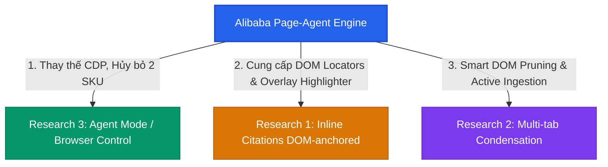

# Nghiên cứu: Ứng dụng Alibaba Page-Agent (In-Page GUI Agent) vào Summarizerrrr

> **QUYẾT ĐỊNH ĐÃ CHỐT (2026-08-15):** **1 SKU duy nhất, Agent Mode chạy JS-only in-page.
> Huỷ hướng 2 SKU / CDP** đã converge 2026-07-31 trong
> [`summarizerrrr-agent-sku-v1.md`](./summarizerrrr-agent-sku-v1.md) (doc đó nay là
> **superseded** cho phần định vị SKU, nhưng §6.3/§8/§9 của nó vẫn là tham chiếu bắt buộc —
> xem "Những gì transfer nguyên" bên dưới). Điều kiện của quyết định: chấp nhận **trần năng
> lực vĩnh viễn** của JS-only, ghi tường minh ở §2.1.1 — không được đọc doc này thành
> "JS tương đương CDP".
>
> **Tài liệu nghiên cứu kiến trúc & tính khả thi** (2026-08-15).
> Đánh giá thư viện [`alibaba/page-agent`](https://github.com/alibaba/page-agent) và tái cấu trúc 3 bài toán nghiên cứu nền tảng:
> 1. `docs/research/summarizerrrr-agent-sku-v1.md` (Năng lực điều khiển browser / Agent Mode)
> 2. `docs/research/chat-inline-citations-v1.md` (DOM-anchored inline citations)
> 3. `docs/research/multi-tab-context-overflow-v1.md` (Multi-tab `@tab` context condensation)
>
> **Nhánh liên quan:** `v3.0-NewSettingUI-2` / `V3.0-refactor-01`.

---

## 1. Context & Động lực mới (Why Now?)

Trong các vòng nghiên cứu trước (tháng 07/2026), việc đưa năng lực "AI điều khiển trình duyệt" vào Summarizerrrr bị kẹt vào một bế tắc kiến trúc lớn:
- Muốn tự động hoá đáng tin cậy thì phải dùng **CDP (`chrome.debugger`)** (theo blueprint của Claude for Chrome / Manus).
- Dùng CDP kéo theo: **buộc phải xin quyền `debugger`**, bị dải banner vàng của Chrome làm xấu UX, không chạy được trên Firefox/Safari, và rủi ro bị Chrome Store tạm ngưng extension khi xin quyền mới.
- Giải pháp lúc đó là **"Từ chối tiền đề" bằng cách chia 2 SKU riêng** (`Summarizerrrr` và `Summarizerrrr:agent` Chrome-only). Tuy nhiên, 2 SKU lại kéo theo chi phí bảo trì 2 listing, 2 build pipeline và phân mảnh tập người dùng.

Sự xuất hiện của **`alibaba/page-agent`** (dựa trên kỹ thuật DOM extraction của `browser-use`, chạy 100% bằng JavaScript client-side trong trang) mang lại một góc nhìn hoàn toàn mới:
1. **Không cần CDP / Không cần quyền `debugger`:** Mọi thao tác (click, input, scroll, select, text extraction) đều thực thi trực tiếp qua In-page DOM Event Dispatching.
2. **Giữ nguyên 1 SKU duy nhất (Cross-browser):** Chạy được trên cả Chrome, Firefox, Edge mà không cần thêm permission nhạy cảm.
3. **Mã nguồn mở, BYO-LLM:** Hỗ trợ mọi model tương thích OpenAI API / Qwen / Gemini / Ollama — khớp tự nhiên với tầng `aiSdkAdapter.js` sẵn có của Summarizerrrr.

---

## 2. Tái đánh giá 3 Research cũ dưới lăng kính Page-Agent



### 2.1. Tác động tới Research 3 (`Summarizerrrr:agent` — Điều khiển Browser)
🔥 **QUYẾT ĐỊNH: BÃI BỎ HƯỚNG TÁCH 2 SKU — chấp nhận trần năng lực JS-only (§2.1.1).**

* **Đảo quyết định CDP-ở-v1 (đã chốt lại 2026-08-15):**
  * Research cũ (§5.2) chốt CDP với lý do "bản đầy đủ mới phát huy được độ tiện ích". Lập
    luận ladder JS-first khi đó đã bị overrule. `page-agent` **không bác được lý do đó** —
    một JS agent có trần năng lực thấp hơn CDP một cách cấu trúc — nhưng nó là bằng chứng
    khả thi mới: với bộ lọc DOM thông minh (bounding box, lọc element ẩn, đánh số tương tác
    `[1]`, `[2]`), In-page JS agent xử lý được các tác vụ form-filling, navigation,
    click/search, data extraction **trên phần lớn trang thông thường**.
  * **Caveat quan trọng về chế độ hoạt động:** định vị gốc của `page-agent` là *"One script
    gives any web page its own AI agent"* — chủ site tự nhúng vào trang **của chính họ**
    (trang hợp tác, same-origin). Summarizerrrr lái trang **bên thứ ba, không hợp tác** —
    một regime khó hơn. Bằng chứng khả thi của họ vì vậy **không transfer tự động**; phải
    PoC trên site mục tiêu thật (bước đầu của Phase 3). Chính team page-agent cũng phải làm
    một Chrome extension riêng cho multi-page tasks — vì in-page script **chết khi full
    navigation** (xem "Resilience" ở §2.1.2).
  * **Hủy bỏ 2 SKU:** Không cần tạo listing mới, không cần fork manifest. Tính năng điều khiển trang web xuất hiện dưới dạng một **"Agent Mode" toggle** ngay trong Sidepanel của extension hiện tại. Chủ dự án chấp nhận trần §2.1.1 để đổi lấy 1 SKU cross-browser, không banner debugger, không rủi ro store-review của quyền `debugger`.
* **Kế thừa hạ tầng Perception & Action (một phần — không phải "trọn gói"):**
  * Repo hiện tại chỉ có `public/accessibility-tree.js` (trích text cơ bản, không có ref, không có toạ độ).
  * `page-agent` cung cấp (đã đọc source 2026-08-15, chi tiết §2.1.3):
    - Bộ dựng cây DOM tương tác ảo (`FlatDomTree`) — port trực tiếp từ `browser-use` (`dom_tree/index.js`, ~1.700 dòng).
    - Đánh số element trong phiên qua `node.ref: HTMLElement` giữ trong RAM (**không xâm lấn DOM** — verified).
    - `actions.ts` (~550 dòng): synthetic event chain chuẩn W3C + React native value setter + `contenteditable` fallback — mảnh **đáng tái dùng nhất**.
  * Fact đã verify: MIT license, ~28.6k stars, `v1.12.2` trên npm, builds on `browser-use` DOM processing; **cũng dùng WXT** như repo này.
* **Các cơ chế an toàn vẫn BẮT BUỘC giữ lại từ Research cũ:**
  1. **ActionMask / Takeover (từ Manus):** Khi agent thao tác trên tab người dùng đang xem, vẫn cần nút *Stop* và *Takeover* (User tự làm $\rightarrow$ Resume) để tránh xung đột thao tác giữa người và AI.
  2. **PII & Password Redaction:** Tuyệt đối không gửi `input[type="password"]` hoặc dữ liệu thẻ tín dụng vào prompt LLM.
  3. **Containment (Phạm vi tab):** Chỉ cho phép Agent chạy trên Active Tab được user cho phép, không tự ý nhảy tab lung tung.
  4. **`domain_transition` grant theo cặp domain, gắn với `navigate`:** đường exfiltration ở doc cũ §8.1 (*text ẩn trong trang A bảo agent điều hướng sang evil.com rồi gõ dữ liệu vừa đọc vào ô tìm kiếm*) **vẫn nguyên với JS-only** — `navigate` + `type` đều nằm trong action set. Bỏ CDP không xoá đường này.

#### 2.1.1. Trần năng lực đã chấp nhận (accepted ceiling — điều kiện của quyết định)

Đây là giới hạn **cấu trúc, vĩnh viễn** của hướng JS-only. Không được coi là bug cần sửa;
là giá đã trả để mua 1 SKU:

| Giới hạn | Vì sao JS không vượt được | CDP thì sao (để đối chiếu) |
| :--- | :--- | :--- |
| Site kiểm tra `isTrusted` (login flows, bot detection, một số player) **bỏ qua synthetic events** | Event dispatch từ JS luôn `isTrusted: false` | CDP `Input.dispatchKeyEvent` là input thật, `isTrusted: true` (doc cũ §8.1) |
| **Cross-origin iframe** (payment, embed) không chạm được | Same-origin policy; content script không xuyên frame khác origin (kể cả `all_frames` cũng cần điều phối per-frame) | `DOM.getDocument({pierce:true})` xuyên được |
| **Closed shadow DOM** không đọc được | `querySelector` không xuyên shadow root `closed` | CDP pierce được |
| **File upload** không fill được | JS không set được `input[type=file]` vì lý do bảo mật trình duyệt | CDP làm được |

**Hệ quả một chiều cần hiểu rõ:** chọn 1-SKU-JS hôm nay làm **CDP-sau-này đắt hơn** — thêm
quyền `debugger` vào listing đang có chính là bài toán "install base bị đóng băng chờ user
duyệt lại" mà doc cũ §1 né bằng listing mới. Nếu trần này về sau chứng minh là quá đau,
đường quay lại vẫn là mở listing thứ hai — quyết định hôm nay không đóng cửa đó, chỉ hoãn nó
cho tới khi có bằng chứng sử dụng thật.

#### 2.1.2. Những gì transfer nguyên từ doc cũ (không phụ thuộc CDP/JS)

* **Thứ tự build (doc cũ §6.3), vẫn bắt buộc:** tool loop phải land ở nền chung **trước**
  — sửa `runGeneration` ([`chatService.js:203`](../../src/services/chat/chatService.js)) +
  cắm `supportsTools` vào `getProviderCapabilities`
  ([`providerCapabilities.js:159`](../../src/lib/chat/providerCapabilities.js)), chứng minh
  bằng tool `search_archive` (không network, không page access) — rồi mới đến
  perception/action. Dựng loop *bên trong* Agent Mode = debug hai cơ chế lạ cùng lúc.
* **Resilience khi navigation (doc cũ §9):** in-page engine chết theo trang; controller ở
  sidepanel sống nhưng phải `ensureContentScriptReady` (ping → re-inject), kiểm
  `snapshotOrigin !== currentOrigin` trước khi dispatch, dedupe theo `toolUseId`. **Không
  cái nào "kế thừa free" từ page-agent** — thư viện của họ không phải giải bài này ở chế độ
  extension.
* **A11y/DOM tree là untrusted source:** bọc bằng đúng cơ chế
  [`sourceFormatter.js`](../../src/lib/chat/contextPipeline/sourceFormatter.js)
  (`[[UNTRUSTED_SOURCE]]` + escape) — điểm tái dùng giá trị nhất, đã có test.
* **Không `execute_javascript` làm tool** (doc cũ §8.2) — với code do model sinh; code cố
  định của mình qua `executeScript` thì bình thường.

#### 2.1.3. Kết quả đọc source page-agent (verified 2026-08-15)

Đọc trực tiếp source (`packages/{page-controller,core,extension,ui}`) — đây là Phase 0 của
Doc 3, ghi lại để không phải đọc lại. Ba claim ⚠️ trước đây nay đã có kết luận:

| Claim (trước là ⚠️) | Kết luận từ source | Bằng chứng |
| :--- | :--- | :--- |
| Locator không xâm lấn | ✅ **Đúng** — perception là `FlatDomTree` in-RAM (`node.ref:HTMLElement`), không `setAttribute` lên element trang. Ngoại lệ: React patch gắn `data-page-agent-not-interactive` lên `#root`/`#app` để loại root khỏi interactive. | `dom_tree/index.js`; `patches/react.ts` |
| Overlay highlighter "tách được thành module" | 🟡 **Sai một nửa** — highlight chỉ là **một `div#playwright-highlight-container` fixed** (`pointer-events:none; z-index:2147483640`) append thẳng vào `body`, logic nằm *trong* `dom_tree/index.js`, **không phải shadow DOM, không phải module rời**. → **tự viết highlighter nhỏ cho citations sạch hơn** (khớp lean Doc 4). | `dom_tree/index.js` |
| PII / password redaction | ❌ **Không có** — literal `@todo 数据脱敏过滤器` (data-masking filter) còn nằm ở `dom/index.ts:191`. → **bắt buộc tự viết**, đúng như §5.1 / §8.5. | `dom/index.ts:191` |

**Phát hiện thêm (đều load-bearing):**
- **`actions.ts` (~550 dòng)** là phần công phu và giá trị nhất: bắn đủ chuỗi 8+ event W3C cho
  `click`, dùng `getNativeValueSetter(HTMLInputElement.prototype)` để `onChange` React chạy đúng,
  và `contenteditable` fallback (`beforeinput` → `execCommand('insertText')` cho Quill/Slate/Draft).
  Mọi event `isTrusted:false` — **xác nhận trần §2.1.1**.
- **`SimulatorMask.ts` (~220 dòng)** giải đúng bài takeover/chống tranh chấp: overlay full-screen
  `pointer-events:auto` chặn mọi event user + **phantom cursor SVG** bay tới element mục tiêu.
  Tham chiếu tốt cho Agent Mode UI *sau PoC*.
- **Navigation-resilience = heartbeat:** MV3 kill service worker + sidepanel không có `unload`
  tin cậy → họ ghi `agentHeartbeat` vào `chrome.storage.local` mỗi 1s; content script mất
  heartbeat >2s thì **tự gỡ mask + dọn highlight**. Đây là lời giải cụ thể cho cleanup mà
  agent-sku doc cũ §7.4 để ngỏ.
- **Kiến trúc extension của họ = WXT**, giống hệt repo này: `MultiPageAgent` ở sidepanel ↔
  background ↔ `RemotePageController.content.ts` mỗi tab. → rủi ro tích hợp thấp hơn tưởng.

**Quyết định vendor-vs-dependency (chốt open question 6b.3): VENDOR chọn lọc, KHÔNG npm-depend.**
Package tách nhiều mảnh và phần hữu ích cần *sửa* (thêm redaction), nên import cả `page-agent`
kéo theo `browser-use`-sized dep là thừa. Lấy về `src/lib/dom/`:

| Module | ~Dòng | Cách lấy |
| :--- | :--- | :--- |
| `dom_tree` (visibility + indexing + bbox) | ~1.700 | Vendor, cắt gọn phần perception |
| `actions.ts` (event dispatcher) | ~550 | Vendor **gần nguyên vẹn** — giá trị nhất |
| `SimulatorMask` (phantom cursor + lock) | ~220 | Tham chiếu, viết lại theo nhu cầu (Agent Mode, sau PoC) |
| Highlight container | (trong dom_tree) | **Không lấy** — tự viết shadow-DOM nhỏ cho citations |
| PII redaction | 0 (chưa có) | **Bắt buộc tự viết** |

⚠️ Các file:line ở trên đến từ một lượt đọc source được relay lại; khi Doc 3 Phase 0 chạy thật,
mở lại source xác nhận trước khi vendor (license MIT — giữ header attribution khi copy).

---

### 2.2. Tác động tới Research 1 (DOM-anchored Inline Citations)
🎯 **HỖ TRỢ MỨC 1–2 CỦA THANG DEGRADE — không giải bài toán cốt lõi.**

**Đặt kỳ vọng cho đúng:** điểm khó cốt lõi của Research 1 là **vòng đời** — anchor
runtime-only nhưng message persist (IndexedDB), nên mở lại conversation là link chết hàng
loạt. Ref của `page-agent` cũng runtime-only y hệt → **nó không đóng góp gì cho bài toán
persistence**. Bài toán đó đã được Research 1 hoà tan bằng thang degrade 4 mức (citation
record tự mang `quote`, mức 4 không bao giờ link chết). `page-agent` chỉ giúp phần *cơ khí*
của mức 1–2:

* **Điểm `page-agent` hỗ trợ (mức 1–2):**
  1. **Locator không xâm lấn** ✅ *verified (§2.1.3)* — perception giữ `node.ref:HTMLElement`
     trong RAM, không ghi attribute lên DOM thật → không lo React hydration xoá. Nhưng nó là
     locator **runtime-only** (như mọi ref), không giúp gì cho persistence — Doc 4 vẫn phải
     tự đánh block-id deterministic lúc capture.
  2. **Highlighter** ❌ *verified: KHÔNG có module tách rời* (§2.1.3) — page-agent chỉ append
     một `div` fixed trong `dom_tree`. → **tự viết `CiteHighlighter`** (shadow-DOM nhỏ,
     self-cleaning) là hướng đúng, không lấy từ page-agent.
  3. **Fuzzy Re-find (Mức 2):** tự viết `window.find`/TreeWalker / Text Fragment.

* **Kết luận build-vs-borrow (đã đọc source):** phần cơ khí citations **tự viết toàn bộ** —
  page-agent không đóng góp module dùng lại được ở đây (highlighter là plain div, không tách).
  Research 1 chưa từng bị chặn ở phần này; đây là code nhỏ, không cần dependency.

---

### 2.3. Tác động tới Research 2 (Multi-tab `@tab` Overflow & Condensation)
⚡ **CAPTURE QUALITY LÚC ATTACH TAB — visibility filter + `waitForDOMStable`, phạm vi deterministic.**

Ràng buộc bất biến của Research 2: **Plain chat client, bảo toàn cache-stable prefix, không chạy agent loop giữa các turn.**

* **Cách áp dụng `page-agent` mà KHÔNG vi phạm Invariants:**
  1. **KHÔNG thay Defuddle — hai loại extraction khác nhau, đừng lẫn:**
     * DOM filter của `page-agent` (thừa kế browser-use) dựng cây **interactive elements để
       hành động** — button, input, clickable. Còn `@tab` cần **nội dung đọc ngữ nghĩa** —
       bài viết, transcript — là việc của `Defuddle` / `semanticPageExtractor.js`. Thay
       Defuddle bằng action-tree sẽ làm extraction đọc *tệ đi*, không tốt lên.
     * Phần thật sự tái dùng được: **visibility filtering** (loại node vô hình/`display:none`
       khỏi text đầu ra) — một mảnh nhỏ, ghép *vào* đường Defuddle hiện có. Mức tiết kiệm
       token **chưa đo** (con số "60–80%" ở bản draft trước là ước đoán không nguồn — đã bỏ).
  2. **Active Ingestion — thu hẹp về phần deterministic:**
     * Điểm yếu thật: trang SPA còn skeleton lúc capture, hoặc nội dung giấu sau *"Xem thêm"* / accordion đóng.
     * Phạm vi đã chốt (khớp grain "manual + visibility" trong memory `multi-tab-overflow-direction` — user đã đẩy lại pipeline tự quyết ngầm khi loại condensation):
       - ✅ **`waitForDOMStable`** (MutationObserver + timeout ~2s) trước khi capture — quick win độc lập, doc cũ §8.5 đã chốt, **không cần page-agent**.
       - ✅ **Expander deterministic per-site** cho vài site đã biết (kiểu nút mở transcript YouTube) — selector cố định, không suy luận.
       - ❌ **KHÔNG micro-action do LLM quyết** ("tự click nút mở rộng nếu có") — cần một LLM call mỗi attach, click nhầm gây side effect *nhìn thấy được* trên tab user đang đọc, và là đúng kiểu magic ngầm đã bị loại.
     * Vì chỉ chạy 1 lần lúc attach (capture-time), phần ✅ giữ vững *Cache-stable prefix* — invariant nói về ổn định turn-to-turn với tập nguồn cố định, không phải lúc add nguồn.

---

## 3. Bảng so sánh: Kiến trúc cũ vs Kiến trúc mới (với Page-Agent)

| Hạng mục | Hướng cũ (CDP / 2 SKU) | Hướng mới (Page-Agent In-page JS) |
| :--- | :--- | :--- |
| **Phân phối sản phẩm** | 2 SKU riêng biệt (`Summarizerrrr` + `Summarizerrrr:agent`) | **1 SKU duy nhất**, toggle "Agent Mode" trong Sidepanel |
| **Quyền trình duyệt** | Cần `debugger`, `tabGroups`, `<all_urls>` | **Chỉ dùng `scripting` + `activeTab` / `host_permissions` sẵn có** |
| **Hỗ trợ trình duyệt** | Chrome-only (Edge hạn chế, bỏ rơi Firefox/Safari) | **Cross-browser** — nhưng Firefox có UX khác: `firefox.content.js` hẹp *có chủ ý*, Agent Mode = xin optional permission **per-site** (không phải bật là chạy mọi trang như Chrome `<all_urls>`) |
| **Trần năng lực** | Cao (`isTrusted: true`, pierce iframe/shadow DOM, file upload) | **Thấp hơn có cấu trúc** — xem §2.1.1, đã chấp nhận |
| **Cảnh báo trình duyệt** | Dải banner debug màu vàng khó chịu của Chrome | **Không có banner cảnh báo**, trải nghiệm mượt mà |
| **Độ phức tạp code DOM** | Phải tự viết lại A11y Tree + toạ độ viewport + zoom DPR | Tái dùng DOM engine của `page-agent` (perception); **resilience navigation + re-inject vẫn tự xây** (§2.1.2) |
| **Inline Citation UI** | Phải tự xây module inject highlight & locator | Tái dùng Overlay Highlighter của `page-agent` *(chưa verify tách được — §2.2)* hoặc tự viết |
| **Xử lý trang SPA** | Thụ động (dễ dính trang skeleton, thiếu nút bấm) | **`waitForDOMStable` + expander deterministic** lúc attach (§2.3 — không LLM micro-action) |
| **Rủi ro Store Approval** | Rất cao (quyền `debugger` bị kiểm duyệt gắt gao) | **Thấp** (APIs tiêu chuẩn, không quyền mới) — nhưng là thay đổi chức năng trên listing đang có install base, khác zero |

---

## 4. Kiến trúc kỹ thuật đề xuất (Proposed Architecture)

```
┌──────────────────────────────────────────────────────────────┐
│                      Sidepanel / Popup UI                    │
│  ┌───────────────────────┐        ┌───────────────────────┐  │
│  │   Chat / Summarizer   │        │   Agent Mode (Mới)    │  │
│  │   (Passive Reader)    │        │  (Active Controller)  │  │
│  └───────────┬───────────┘        └───────────┬───────────┘  │
└──────────────┼────────────────────────────────┼──────────────┘
               │                                │
               ▼                                ▼
┌──────────────────────────────────────────────────────────────┐
│                    Service & Adapter Layer                   │
│  ┌────────────────────────────────────────────────────────┐  │
│  │  aiSdkAdapter.js (Multi-provider: Gemini, Qwen, Ollama)│  │
│  └────────────────────────────────────────────────────────┘  │
│  ┌────────────────────────────────────────────────────────┐  │
│  │  PageAgentController (Điều phối Agent Loop & Safety)   │  │
│  └────────────────────────────────────────────────────────┘  │
└──────────────────────────────┬───────────────────────────────┘
                               │ (browser.tabs.sendMessage)
                               ▼
┌──────────────────────────────────────────────────────────────┐
│             In-Page Content Script (Target Tab)              │
│  ┌────────────────────────────────────────────────────────┐  │
│  │  PageAgent DOM Engine:                                 │  │
│  │  • DOM Tree Distillation & Numeric Indexing ([1], [2]) │  │
│  │  • PII / Password Redaction Layer                      │  │
│  │  • Action Dispatcher (click, type, scroll, select)     │  │
│  │  • Shadow DOM ActionMask & CiteHighlighter             │  │
│  └────────────────────────────────────────────────────────┘  │
└──────────────────────────────────────────────────────────────┘
```

### 4.1. Tầng Content Script (`page-agent-core`)
- Được đóng gói như một module nội bộ (hoặc unlisted script) trong `src/entrypoints/`.
- Chịu trách nhiệm 3 việc:
  1. **Perceive:** Quét DOM hiện tại, lọc node tàng hình, đánh số ID cho các interactive element, trả về text tree ngắn gọn.
  2. **Execute:** Nhận lệnh action từ Sidepanel (`click(id)`, `type(id, text)`, `scroll(dir)`), dispatch synthetic events (luôn `isTrusted: false` — trần §2.1.1; site kiểm tra isTrusted sẽ không phản hồi).
  3. **Visual Feedback:** Render Shadow DOM overlay hiển thị bounding box các element được đánh số và hiệu ứng highlight khi nhảy citation.

### 4.2. Tầng Controller (`PageAgentController.js`)
- Nằm ở Sidepanel / Background.
- Nhận goal từ người dùng (ví dụ: *"Điền form đăng ký này giúp tôi..."*).
- Điều phối vòng lặp Agent Loop:
  1. Yêu cầu Content Script gửi snapshot DOM đã lọc.
  2. Ghép prompt vào `aiSdkAdapter.js` gọi LLM sinh action.
  3. Gửi action xuống Content Script thực thi.
  4. Lặp lại cho đến khi hoàn thành hoặc đạt `maxSteps` (giới hạn an toàn ~10-15 bước).

---

## 5. Ràng buộc bất biến & An toàn (Load-Bearing Invariants)

Bất kỳ kế hoạch triển khai nào sử dụng `page-agent` đều **PHẢI TUÂN THỦ** các nguyên tắc sau:

1. **Không làm rò rỉ dữ liệu nhạy cảm (PII & Password Redaction):**
   - Trước khi cây DOM được biến thành text gửi lên LLM, Content Script **bắt buộc** phải redact:
     `input[type="password"]`, trường số thẻ tín dụng (`cc-number`, `cc-csc`), mã OTP (`one-time-code`), token ẩn.
2. **Bảo toàn ranh giới giữa Chat thường và Agent Loop:**
   - Khi ở chế độ **Chat / Summarize**: Tuyệt đối không kích hoạt agent loop giữa các turn (giữ nguyên nguyên tắc *Cache-stable prefix* của `contextBudgeter.js`).
   - Khi ở chế độ **Agent Mode**: Người dùng phải chủ động bật toggle, và giao diện phải hiển thị rõ trạng thái đang thực thi từng bước (Step-by-step trace).
3. **Luôn có cơ chế Takeover (Nhường quyền cho User):**
   - Phải có nút **Dừng lại (Emergency Stop)** và overlay **Takeover** hiển thị trên tab. Khi user can thiệp vào trang, Agent phải tạm dừng ngay lập tức.
4. **Nguồn dữ liệu là Untrusted:**
   - Nội dung trên trang web vẫn có thể chứa Prompt Injection. Các chỉ thị đọc từ DOM phải luôn được bọc trong block `[[UNTRUSTED_SOURCE]]` và escape theo chuẩn của `sourceFormatter.js`.

---

## 6. Lộ trình triển khai khuyến nghị (Phased PoC Roadmap)

### Phase 1: Verify source + trích xuất DOM & Highlighter (Quick Win)
- **Bước 0 (bắt buộc, trước mọi thiết kế):** đọc source `page-agent` để verify 3 claim đang
  đánh dấu ⚠️ trong doc: locator non-mutating, highlighter tách được thành module, hành vi
  khi navigation. Kết quả quyết định build-vs-borrow (§2.2).
- **Mục tiêu:** Tách (hoặc tự viết tương đương) `dom-tree` visibility filter và `overlay highlighter`.
- **Ứng dụng:**
  - Ghép visibility filtering vào đường `semanticPageExtractor.js` (KHÔNG thay Defuddle — §2.3), đo mức tiết kiệm token thật.
  - Xây **Click Citation `[a2]` $\rightarrow$ Scroll & Highlight** trên tab nguồn (mức 1–2 của thang degrade Research 1).
- **Rủi ro:** thấp (không đụng vòng lặp Agent hay quyền điều khiển).

### Phase 2: Capture quality cho Multi-tab `@tab`
- **Mục tiêu:** `waitForDOMStable` trước capture + expander deterministic per-site (§2.3 — phạm vi đã thu hẹp, không LLM micro-action).
- **Ứng dụng:** Cải thiện chất lượng snapshot nguồn cho pipeline `@tab` (Research 2) mà không phá vỡ cache invariant.

### Phase 3: "Agent Mode" trong Sidepanel — theo thứ tự đã chốt ở doc cũ §6.3
Thứ tự này transfer nguyên, không phụ thuộc CDP/JS (§2.1.2):
1. **PoC trần năng lực:** chạy engine page-agent (qua content script) trên ~10 site mục tiêu
   thật; đo tỉ lệ thành công click/type/select; ghi rõ site nào fail vì
   `isTrusted`/iframe/shadow DOM. Đây là bước biến "khả thi ở trang hợp tác" thành bằng
   chứng trên regime thật (§2.1). Kết quả tệ hơn kỳ vọng → dừng lại đánh giá, chưa build UI.
2. **Tool loop ở nền chung trước:** `supportsTools` gate
   ([`providerCapabilities.js:159`](../../src/lib/chat/providerCapabilities.js)) → tool loop
   trong `runGeneration` ([`chatService.js:203`](../../src/services/chat/chatService.js)) →
   chứng minh bằng `search_archive` (không network, không page access).
3. **Agent Mode:** toggle trong Sidepanel; `PageAgentController` + `aiSdkAdapter.js` +
   Takeover Mask + `domain_transition` grants (§2.1 mục an toàn #4) + resilience navigation
   (§2.1.2). Ứng dụng: Smart Form Filling, Web Navigation, Table Data Extraction.

---

## 6b. Câu hỏi mở (chưa giải — sẽ đổi thiết kế nếu trả lời khác đi)

1. **Token budget cho agent turn** (kế thừa open question #5 doc cũ, vẫn chưa giải): loop
   đắp dồn DOM snapshot qua 10–15 bước; `contextBudgeter` chia ngân sách cố định cho *một*
   turn, không mô hình hoá tích luỹ; estimator `chars/4` hụt ~1.4× tiếng Việt. Agent Mode
   cần cơ chế ngân sách riêng hay tái dùng budgeter với reserve khác?
2. **Kết quả PoC trần năng lực** (Phase 3 bước 1): tỉ lệ fail thực tế trên site mục tiêu là
   bao nhiêu — trần §2.1.1 là "hiếm khi chạm" hay "đau hàng ngày"?
3. ~~**Vendor hay depend?**~~ ✅ **ĐÃ CHỐT 2026-08-15 (§2.1.3): vendor chọn lọc vào
   `src/lib/dom/`** (`dom_tree` cắt gọn + `actions.ts` gần nguyên vẹn), KHÔNG npm-depend; tự
   viết redaction + highlighter. Giữ header attribution MIT khi copy.
4. **Takeover resume summary** (doc cũ #3): user tự gõ "tôi đã làm gì" hay agent re-perceive?
5. **Firefox:** luồng optional-permission per-site cho Agent Mode — UX cụ thể thế nào, và có
   ship Agent Mode trên Firefox ngay v1 không hay Chrome/Edge trước?

---

## 7. Tài liệu tham chiếu liên quan

- Mã nguồn thư viện: [`alibaba/page-agent`](https://github.com/alibaba/page-agent)
- Research tiền thân:
  - [`docs/research/summarizerrrr-agent-sku-v1.md`](./summarizerrrr-agent-sku-v1.md)
  - [`docs/research/chat-inline-citations-v1.md`](./chat-inline-citations-v1.md)
  - [`docs/research/multi-tab-context-overflow-v1.md`](./multi-tab-context-overflow-v1.md)
- Điểm chèn adapter & pipeline trong repo:
  - `src/lib/api/aiSdkAdapter.js` (Tầng gọi AI đa provider)
  - `src/services/contentService.js` (Tầng trích xuất nội dung trang)
  - `src/lib/chat/contextPipeline/sourceFormatter.js` (Guardrail chống prompt injection)
